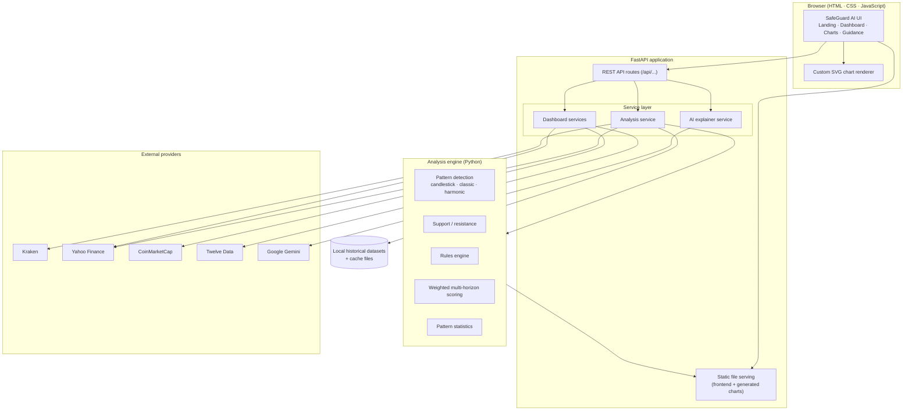
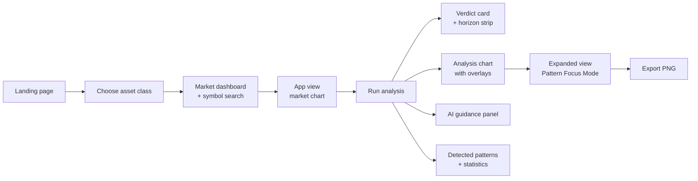
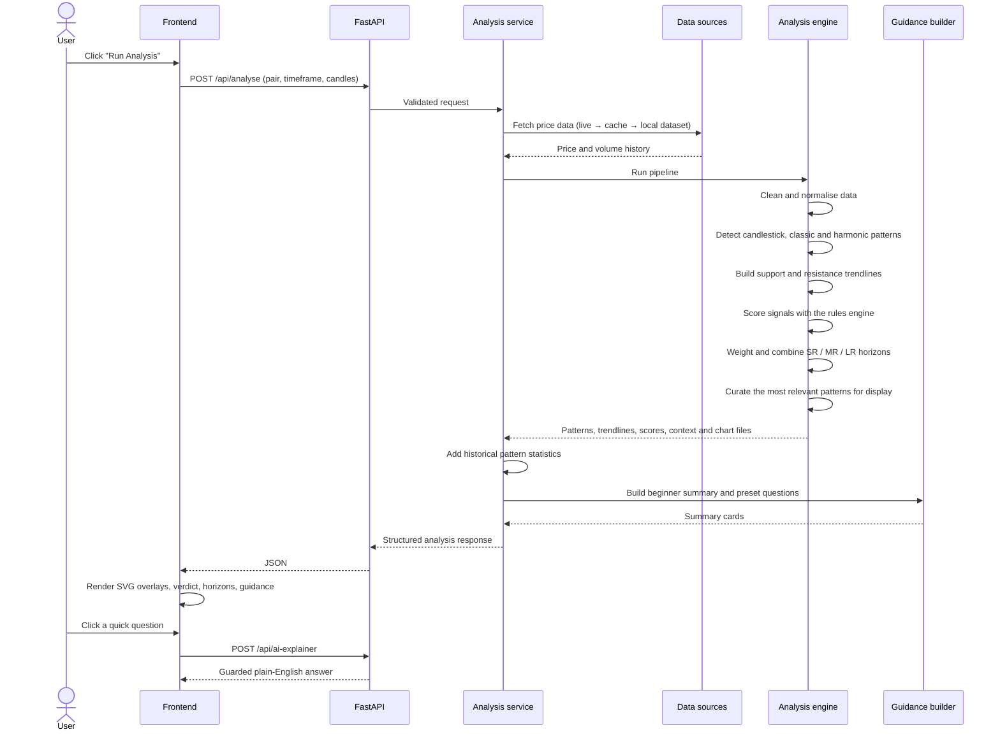
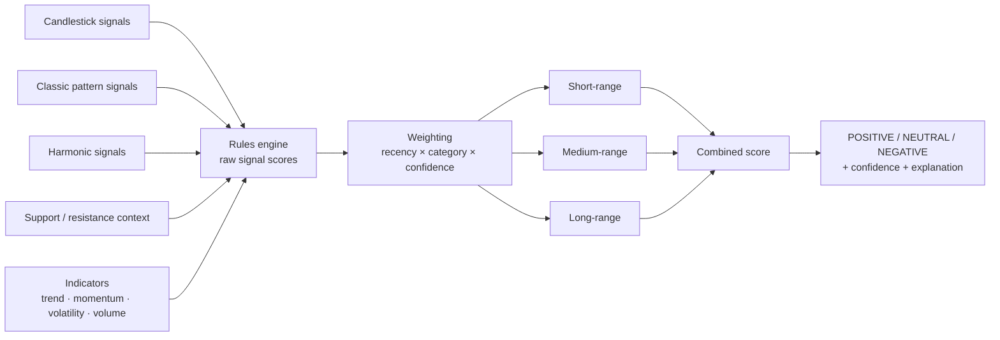
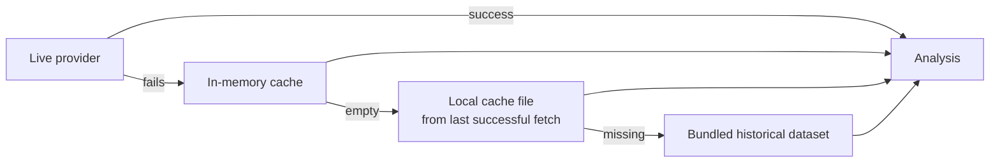
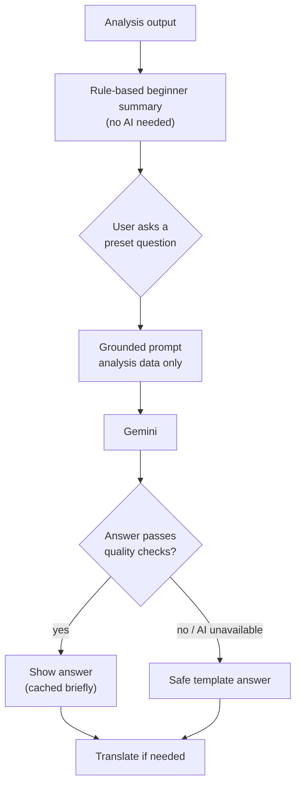

# SafeGuard AI — Project Walkthrough

> **Know before the market moves.**
> An explainable market-analysis platform that detects chart patterns, scores market context across multiple time horizons, and explains the result in plain language, without ever giving financial advice.

**Python** · **FastAPI** · **Pydantic** · **JavaScript (vanilla)** · **SVG** · **pandas / NumPy / SciPy** · **mplfinance** · **Google Gemini**

### ▶️ [Watch the demo video](https://drive.google.com/file/d/1o3Gb-PuWrhdoMTpZ0ORdE5zGOOrvLJmS/view)

See the full application in action: asset dashboards, live charts, pattern detection, multi-horizon scoring and AI guidance.

---

## About this repository

SafeGuard AI was built as a **capstone project for COMP5703 at the University of Sydney**.

The source code is **not published**. This is to protect academic integrity and the confidentiality agreements that applied to the project. This repository contains only this document: a full walkthrough of what the application does, how it is built, and how its parts fit together.

---

## Table of contents

1. [Overview](#overview)
2. [Key features](#key-features)
3. [System architecture](#system-architecture)
4. [Technology stack](#technology-stack)
5. [User journey walkthrough](#user-journey-walkthrough)
6. [How an analysis works end to end](#how-an-analysis-works-end-to-end)
7. [The analysis engine](#the-analysis-engine)
8. [Data pipeline and resilience](#data-pipeline-and-resilience)
9. [AI guidance and responsible-AI design](#ai-guidance-and-responsible-ai-design)
10. [Frontend implementation highlights](#frontend-implementation-highlights)
11. [API overview](#api-overview)
12. [Validation approach](#validation-approach)
13. [Project structure](#project-structure)
14. [Skills demonstrated](#skills-demonstrated)
15. [Disclaimer](#disclaimer)

---

## Overview

### The problem

Price charts are full of information, but reading them takes experience. New investors are told to look for things like "head and shoulders", "support levels" or "bullish engulfing candles". Spotting those structures reliably is hard, and so is knowing how much weight to give them or what they mean together. Most tools that do this are either black-box "buy/sell" signal generators or professional platforms with a steep learning curve.

### The solution

SafeGuard AI is a web application that:

- **Detects** candlestick, classic chart, harmonic and support/resistance structures on real market data.
- **Scores** those signals with a transparent, rule-based weighting model across short, medium and long horizons.
- **Visualises** everything directly on an interactive chart, so users can *see* why the system reached its conclusion.
- **Explains** the result in beginner-friendly language using an AI layer that is deliberately limited to *context*: it never recommends buying, selling or holding.

It covers four asset classes, **crypto, stocks, commodities and forex**, in one interface.

---

## Key features

| Area | What it does |
|---|---|
| **Multi-asset coverage** | Crypto, stocks, commodities and forex, each with its own search, symbol handling and data source. |
| **Market dashboards** | A market overview before analysis: leaders, market tables and, for crypto, a live Fear & Greed gauge. |
| **Live-aware charts** | Market chart that refreshes on a timer, with 1-minute, 1-hour, 1-day and full-history views. |
| **Pattern detection** | 65 pattern rules across 4 analysis layers: candlestick, classic, harmonic and support/resistance. |
| **Multi-horizon scoring** | Short-range (SR), medium-range (MR) and long-range (LR) context combined into one overall read. |
| **Verdict card** | Bullish / Bearish / Neutral read with a confidence level, headline, tags and per-horizon breakdown. |
| **Pattern filters** | Switch the chart between All, Classic, Harmonic and Candlestick overlays. |
| **Expanded analysis view** | Full-screen chart with "Pattern Focus Mode" to jump between detected patterns. |
| **PNG export** | Download a high-quality snapshot of the annotated chart. |
| **AI market guidance** | Plain-English summary and preset questions answered by a guarded AI layer. |
| **Multilingual** | Guidance available in 8 languages, including right-to-left support for Arabic. |
| **Graceful degradation** | The app keeps working when external data or AI providers are unavailable. |

---

## System architecture

The whole application runs as **one FastAPI process** that serves both the API and the static frontend. No separate frontend server or build step is needed.



### Layer responsibilities

- **Frontend:** a single-page experience written in plain HTML, CSS and JavaScript. It handles navigation, chart rendering, filters, polling, language switching and calls to the API.
- **API layer:** thin FastAPI routes with Pydantic request and response models for validation and a consistent data shape.
- **Service layer:** coordinates the work. It fetches and caches market data, runs the analysis pipeline, builds dashboards, and handles everything that touches the AI.
- **Analysis engine:** a pure-Python library that turns raw price data (open, high, low, close, volume) into detected patterns, trendlines, scores and readable context.
- **External providers:** live data and AI. Each provider is optional, and a failure in one never stops the app from running.

---

## Technology stack

| Layer | Technology |
|---|---|
| Frontend | HTML5, CSS3, vanilla JavaScript, hand-built SVG charting, Google Fonts (Inter, JetBrains Mono) |
| Backend | Python 3.11, FastAPI, Uvicorn, Pydantic v2 |
| Data processing | pandas, NumPy, SciPy |
| Pattern detection | Custom rule-based detectors + the open-source `pyharmonics` library |
| Server-side chart images | matplotlib, mplfinance |
| Market data | Kraken (crypto prices), Yahoo Finance (stocks, commodities, forex), CoinMarketCap (crypto dashboard), Twelve Data (stock & forex dashboards) |
| AI | Google Gemini (explanations and translation) with a local rule-based fallback |
| Configuration | Environment variables for provider API keys |

---

## User journey walkthrough

> 🎥 Prefer to watch? The [demo video](https://drive.google.com/file/d/1o3Gb-PuWrhdoMTpZ0ORdE5zGOOrvLJmS/view) walks through every step below.



### 1. Landing page

The user lands on a dark, space-themed page with an animated starfield background, the SafeGuard shield logo and the tagline *"Know before the market moves."*

Four cards show the supported asset classes:

| Card | Examples |
|---|---|
| Crypto | BTC, ETH, SOL |
| Stocks | AAPL, MSFT, NVDA |
| Commodities | Gold, Silver, Oil |
| Forex | AUD/USD, AUD/JPY, AUD/GBP |

A footer strip summarises the engine: **65 Pattern Rules · 4 Analysis Layers · 3 Time Horizons (SR · MR · LR)**.

### 2. Asset search and market dashboard

Selecting an asset class opens a search page that includes a **live market dashboard** for that class:

- **Crypto:** total market cap, 24-hour volume, Bitcoin dominance, number of active coins, top movers, a top-10 table and an animated **Fear & Greed gauge**.
- **Stocks:** major index ETFs and leading stocks, market open/closed status, market breadth, and an overall "Risk-On / Defensive / Mixed" tone.
- **Commodities:** gold, silver, crude oil, copper and natural gas, with their daily moves.
- **Forex:** major AUD pairs and an overall "AUD strength" summary.

Quick-pick chips fill the search box with popular symbols. Crypto symbols are looked up live against a market-data directory, so most listed coins can be searched, not only the defaults. Stock tickers are accepted directly, and commodity and forex symbols are checked against supported lists before the user moves on.

### 3. App view: market chart and analysis chart

The main workspace is split into two resizable panels:

- **Market chart (left):** live candlesticks with volume. It has timeframe buttons (1m / 1h / 1d / All), pan and zoom controls, and status pills showing price, open/high/low/close, volume and range. While a short timeframe is selected, the chart refreshes automatically on a timer.
- **Analysis chart (right):** starts empty until the user clicks **Run Analysis**. It then shows the same price data with colour-coded pattern boxes, labels and support/resistance trendlines.

The two charts zoom and pan **together**, so the market view and the analysed view always line up. A notice warns the user when the market has moved on since the last analysis, and the analysis refreshes itself when a new candle arrives.

### 4. Verdict card and horizon strip

After an analysis runs, a **verdict card** summarises the result:

- A direction arrow and label: **BULLISH / BEARISH / NEUTRAL**
- A confidence badge
- A one-line headline
- Tags such as pattern count, overall read, score and an "alignment bonus" when all signals agree

Below it, a **horizon strip** shows the **Short-Range, Medium-Range and Long-Range** reads separately. Each has a score bar and its top contributing signals, so the user can see where the short-term and long-term pictures agree or disagree.

### 5. "How Analysis & Scoring Works" panel

A drop-down panel explains in plain terms how signals are weighted and combined. The aim was **transparency**: users should understand *how* the verdict was reached, not just accept it.

### 6. AI guidance panel ("Safeguard Intelligence")

A guidance panel turns the technical output into beginner-friendly language:

- **Four summary cards:** *Market Read*, *Best Next Step*, *Risk Level* and *What To Watch*.
- **Quick questions** the user can click, for example:
  - "What is the market telling me right now?"
  - "What is the safest next step here?"
  - "Why does this setup look risky or steady?"
  - "What would make this setup look better?"
  - "Explain this in simple terms."
- A **Safeguard Insight** card that shows the answer.
- A clear, always-visible **disclaimer**: the tool explains the chart. It does not recommend buying, selling or holding, does not provide personalised advice, and is not a financial adviser.

### 7. Detected patterns list

An expandable list shows every curated pattern with its direction, type and confidence, plus a plain-English description of what the pattern usually means.

For classic chart patterns, a **Pattern Statistics** section adds Bulkowski-style historical context measured from the asset's own data. It includes how often similar patterns failed, their average move, how often they reached their target, how often price pulled back to the breakout level, and how large the sample was. Patterns that have not broken out yet are labelled **"Awaiting Breakout."**

### 8. Expanded view and Pattern Focus Mode

**Expand Chart** opens a full-screen analysis view:

- Toggle between **Analysis View** (with overlays) and **Clean View** (price only).
- **Pattern Focus Mode:** a side rail lists every detected pattern. Clicking one zooms the chart to that pattern and highlights it. *Previous / Next* buttons step through patterns in order.
- The same filter bar (All / Classic / Harmonic / Candlestick).
- **Export PNG** saves the annotated chart as an image with the pair name and a timestamp in the file name.

### 9. Language switcher

A floating language button switches the guidance experience between **English, Turkish, Chinese (Simplified), Arabic, Russian, German, Spanish and Portuguese**. Arabic switches the layout to right-to-left. The chosen language is remembered for the next visit.

---

## How an analysis works end to end



Every analysis request gets a **unique ID**. Its outputs are also saved as files: annotated chart images, a CSV of detected signals, and JSON files with the technical and multi-horizon context. That makes each run traceable and reviewable after the fact.

---

## The analysis engine

The engine is **fully rule-based and explainable**. There is no black-box machine-learning model deciding the verdict. Every signal can be traced back to a named pattern, a trendline or an indicator condition. This was a deliberate design choice for a tool aimed at beginners, who need to be able to trust and understand the output.

### Layer 1: Candlestick patterns

Single-, two- and three-candle formations are detected from the proportions of each candle's body and wicks and how it relates to the candles before it. Detected formations include:

- **Doji family:** Doji, Dragonfly Doji, Gravestone Doji
- **Hammer family:** Hammer, Inverted Hammer, Hanging Man, Shooting Star
- **Reversal pairs:** Bearish Engulfing, Bullish Harami, Bearish Harami, Piercing Pattern, Dark Cloud Cover
- **Star formations:** Star, Doji Star, Rain Drop, Rain Drop Doji, Morning Star, Morning Star Doji

The candlestick detectors are built as a small plug-in library: each pattern is its own module that shares a common scanning base.

### Layer 2: Classic chart patterns

Larger price structures are found by locating **swing highs and lows (pivots)** within a sliding window and testing their geometry. The tests check whether the pivots are level, rising or falling, whether trendlines converge or run parallel, and whether price has broken out. Detected patterns include:

- Head & Shoulders and Inverse Head & Shoulders
- Double Top / Double Bottom, Triple Top / Triple Bottom
- Ascending, Descending and Symmetrical Triangles
- Rising and Falling Wedges
- Ascending and Descending Channels
- Rectangles
- Flags and Pennants
- Cup & Handle
- Diamond Top / Diamond Bottom
- Megaphone (broadening formation)

When the same pattern is detected on several bars in a row, the detections are merged so each pattern is reported once.

### Layer 3: Harmonic patterns

Harmonic patterns are five-point (X-A-B-C-D) price structures defined by **Fibonacci-ratio relationships** between their legs. The engine detects:

- Gartley
- Bat
- Butterfly
- Crab
- Shark
- Cypher

There are two independent sources. One is an in-house detector that works on swing points. The other is the open-source **pyharmonics** library, which provides a second opinion and can also show patterns that are still forming.

### Layer 4: Support and resistance

Instead of flat horizontal lines, the engine builds **diagonal trendlines** through swing pivots and ranks them by how many times price has respected them, how well they fit, and how recent they are. Lines are built at two scopes:

- **Global:** from the entire price history
- **Local:** from recent price action only

The best support line and the best resistance line are chosen for display on the chart.

### Scoring: from signals to a verdict



1. **Rules engine.** Each detected pattern produces a raw signal score. The score is adjusted by **market context**: the prevailing trend (from moving averages), momentum (RSI), volatility (ATR), volume spikes, and whether the pattern formed near a support or resistance line. For example, a bullish reversal candle that appears near support during a downtrend counts for more than the same candle in the middle of nowhere.
2. **Weighting.** Signals are weighted by:
   - **Recency:** newer bars count more.
   - **Category:** structural patterns such as harmonics and classic formations carry more weight than single candles.
   - **Confidence:** stronger, cleaner detections count more.
3. **Multi-horizon view.** The same signals are evaluated under three different recency profiles, **short-range, medium-range and long-range**, so the user can see whether the read holds across time scales.
4. **Combination.** The three horizons are blended into one score, classified as **Positive, Neutral or Negative**. A confidence level reflects how well the horizons agree, and an *alignment bonus* applies when every signal points the same way. A templated explanation describes why the system reached that read.

### Pattern statistics

For classic chart patterns, the engine looks back through the asset's own history to measure how comparable patterns played out. It records:

- the breakout direction
- the size of the follow-through move
- whether the measured-move target was reached
- how often price pulled back to the breakout level
- how often the pattern failed outright

The results are grouped by pattern and direction, and every statistic is labelled with its sample size so users can judge how reliable it is.

### Display curation

A busy chart helps nobody, so the engine ranks every detection by source, recency, size and confidence. It removes overlapping duplicates and keeps only a small, readable set of the most relevant patterns for display.

---

## Data pipeline and resilience

### Data sources by asset class

| Asset class | Chart and analysis data | Dashboard data |
|---|---|---|
| Crypto | Kraken public market data (Yahoo Finance as a secondary source) | CoinMarketCap |
| Stocks | Yahoo Finance | Twelve Data |
| Commodities | Yahoo Finance (futures contracts) | Yahoo Finance, with Twelve Data as backup |
| Forex | Yahoo Finance | Twelve Data |

### Fallback chain

Market data APIs can be rate-limited, slow or offline, so price data is loaded through a **layered fallback chain**:



- **In-memory caching** with time limits that scale with the timeframe: short-interval data expires quickly and daily data lasts longer.
- **Daily data** is merged with the bundled historical datasets, giving the long price history needed for long-range patterns.
- **Dashboards** never crash the UI. If a provider is missing or rate-limited, the endpoint returns a clear "unavailable" status and the interface hides or simplifies that section.

### Bundled historical datasets

The project ships with daily price history so analysis still works offline. Dataset generator scripts were written to rebuild these files from public market data.

| Class | Assets | Coverage |
|---|---|---|
| Crypto | BTC, ETH, SOL, XRP, ADA | 2020 – 2025 (daily) |
| Stocks | AAPL, MSFT, NVDA, AMZN, GOOGL | 2020 – 2026 (daily) |
| Commodities | Gold, Silver, Crude Oil, Copper, Natural Gas | 2020 – 2026 (daily) |
| Forex | AUD vs USD, EUR, GBP, JPY, NZD, CAD, CNY, HKD, INR | 2020 – 2026 (daily) |

---

## AI guidance and responsible-AI design

A key goal was to make AI **useful for beginners without turning it into an unlicensed financial adviser**. Every part of the guidance layer is built around that constraint.



### Design principles

1. **Rule-based summary first.** The four summary cards (Market Read, Best Next Step, Risk Level, What To Watch) are produced **deterministically from the analysis**, not by the AI. Risk is raised automatically when signals conflict or when price is approaching an opposing support or resistance line.
2. **Preset questions only.** Users choose from a fixed set of questions. There is no free-text box, which removes a whole class of prompt misuse and off-topic requests.
3. **Grounded prompts.** The AI receives only the analysis results: the summary, top signals, nearby trendlines and the three horizon reads. It is told not to invent facts.
4. **Explicit guardrails in the prompt.** No direct financial advice, no guarantees, plain language, short answers, and say clearly when signals are mixed.
5. **Output checks with a safe fallback.** Answers that are too short or malformed are replaced with a pre-written template answer. The same template is used when the AI service is unavailable, rate-limited or not configured. The guidance panel always shows something sensible.
6. **Caching.** Successful answers are cached briefly to cut cost and latency on repeat questions.
7. **Translation that preserves meaning.** When a non-English language is selected, the guidance is translated. Tickers, timeframes, pattern names and numbers are left unchanged so the meaning stays the same.
8. **Visible disclaimer.** The interface always states that the tool explains the chart and does not recommend buying, selling or holding any asset.

---

## Frontend implementation highlights

- **Custom SVG chart renderer.** Candles, volume bars, gridlines, axes, pattern boxes, labels and trendlines are all drawn as SVG by hand-written code. No charting library is used, which gave full control over overlays and styling.
- **Colour-coded overlays.** Classic, harmonic and candlestick patterns each have their own colour. Labels are staggered across rows with leader lines so they don't overlap.
- **Shared viewport.** The market and analysis charts share one zoom and pan state (mouse wheel, drag or buttons). The expanded view keeps its own viewport.
- **Hover crosshair.** Hovering shows a crosshair with a tooltip of the candle's open, high, low, close and volume.
- **Live polling.** Each timeframe has its own refresh interval. When a new candle closes, the analysis is marked stale and re-runs automatically.
- **Resizable split view.** A draggable divider between the two charts, with sensible limits and double-click to reset.
- **PNG export.** The SVG chart is drawn onto a canvas and downloaded as an image.
- **Resilient rendering.** If rendering in the browser fails, the UI falls back to the chart images generated on the server.
- **No build step.** Plain HTML, CSS and JavaScript served directly by the backend. That keeps deployment to a single command.
- **Visual design.** A dark navy, space-inspired theme with green and red market colours, pill-shaped chips, translucent "glass" cards and smooth page transitions.

---

## API overview

| Method | Route | Purpose |
|---|---|---|
| `GET` | `/` | Serves the SafeGuard AI web interface |
| `GET` | `/api/health` | Health check |
| `GET` | `/api/ohlcv` | Price and volume history for the selected asset and timeframe |
| `POST` | `/api/analyse` | Runs the full technical-analysis pipeline |
| `POST` | `/api/ai-explainer` | Returns a guarded, plain-English answer to a preset question |
| `POST` | `/api/guidance-localize` | Translates the guidance into the selected language |
| `GET` | `/api/crypto-dashboard` | Crypto market overview and Fear & Greed sentiment |
| `GET` | `/api/crypto-symbol/resolve` | Resolves a crypto search term to a tradable pair |
| `GET` | `/api/stocks-dashboard` | Stock market overview |
| `GET` | `/api/commodities-dashboard` | Commodities overview |
| `GET` | `/api/forex-dashboard` | Forex overview |

All request and response bodies are defined as typed Pydantic models, so inputs are validated and every caller gets the same response shape.

---

## Validation approach

### Hold-out confirmation

A command-line validation tool checks whether the engine's read **holds up on data it has not seen**:

1. The final part of the price history is hidden.
2. The engine makes a **"blind" prediction** using only the earlier data.
3. It then analyses the hidden period and checks whether the outcome **confirms** the blind read.
4. It also checks whether the support and resistance lines drawn from the blind data **held or broke** once price reached them.

### Rolling walk-forward validation

The same idea is repeated at several cut-off points moving forward through the history. This gives a **confirmation rate** across many windows instead of relying on a single test.

### AI guardrail testing

A test script runs the real analysis pipeline on an asset, sends each preset question to the AI explainer, and scans the answers for advisory language such as buy or sell recommendations. Any answer that matches is reported as a failure.

---

## Project structure

```text
SafeGuard AI
├── frontend/      # Web interface: HTML page, styles, JavaScript app, SVG chart renderer, logos
├── backend/       # FastAPI app, request/response schemas and the service layer
│   └── services/  # Analysis, crypto dashboard, stock/forex/commodity dashboard and AI explainer services
├── analysis/      # Core engine: pipeline, rules engine, weighted scoring, support/resistance, pattern statistics
├── candlestick/   # Pattern-detection library: candlestick, classic and harmonic detectors
├── Dataset/       # Bundled daily historical data for crypto, stocks, commodities and forex
├── scripts/       # Dataset generators and library debugging utilities
├── tools/         # Validation workflow and AI guardrail tests
└── public/        # Brand assets
```

---

## Skills demonstrated

- **Full-stack engineering:** a FastAPI backend and a framework-free JavaScript frontend, delivered as one deployable service.
- **Quantitative and technical analysis:** turning textbook chart-pattern theory into reliable, testable detection rules and a transparent scoring model.
- **Data visualisation:** a custom interactive SVG charting engine with overlays, synchronised viewports, focus navigation and image export.
- **Resilient system design:** multi-provider data integration with caching, fallbacks and graceful degradation.
- **Responsible AI:** using a large language model in a constrained, grounded and non-advisory way, with deterministic fallbacks.
- **Internationalisation:** guidance in 8 languages, including right-to-left layout support.
- **Validation thinking:** hold-out and walk-forward testing to check results against unseen data.

---

## Disclaimer

SafeGuard AI is an **educational project**. It explains chart structure and market context. It **does not** provide financial advice and does not recommend buying, selling or holding any asset. It is not a financial adviser, broker or portfolio manager.

The source code is kept private for academic-integrity and confidentiality reasons. Where permitted, it may be available privately on request.
